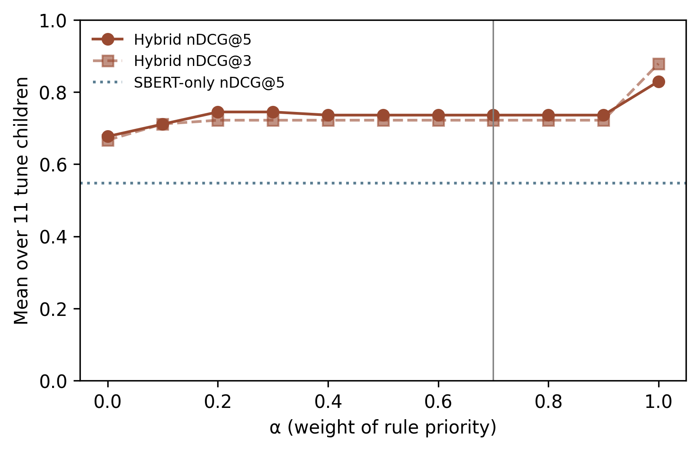
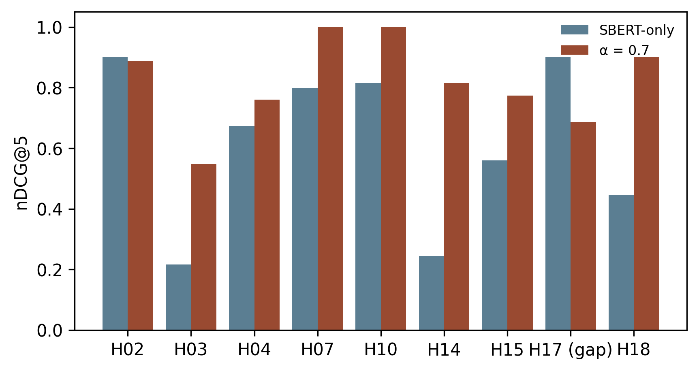
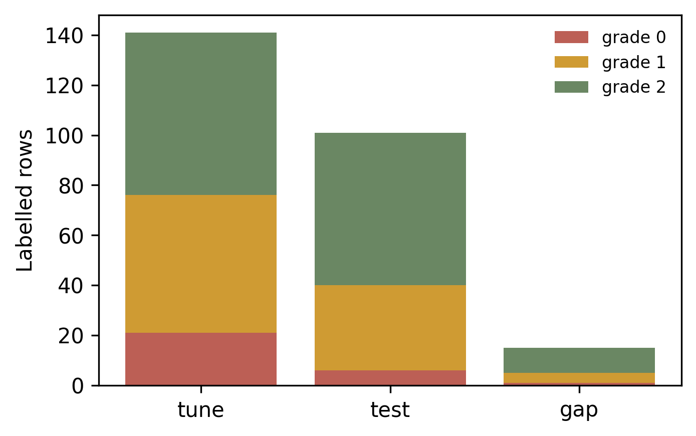
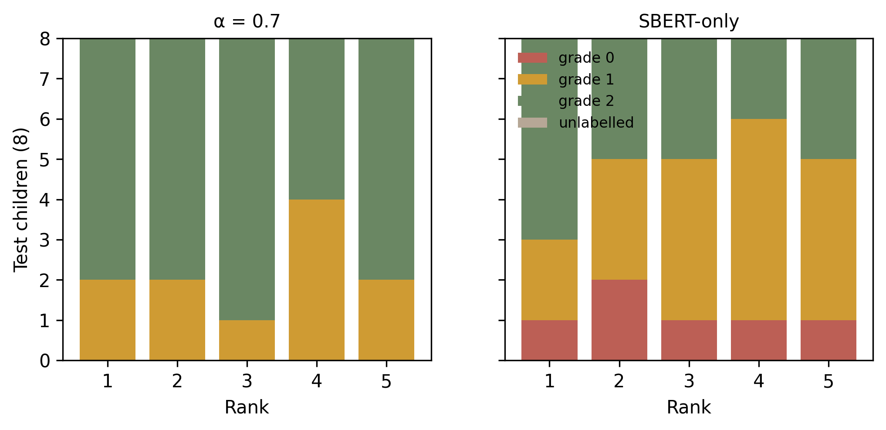
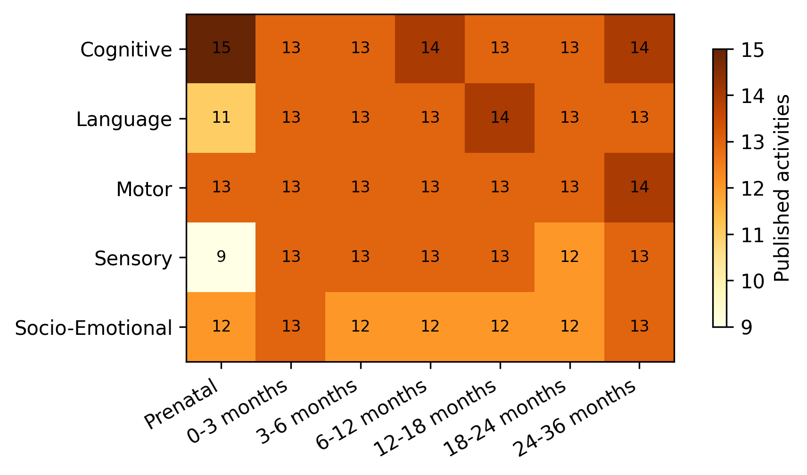

# Figures

> Generated 2026-11-21T00:55:00+03:00 at commit `82ba4a5` by `scripts\report_evidence\.venv\Scripts\python.exe scripts\report_evidence\make_figures.py`. PNG at 300 dpi.

| Figure | Shows | Data | Insight |
|---|---|---|---|
| `figures/alpha_curve.png` | α curve with the SBERT-only line (tune) | `raw/alpha_curve.csv` | Tune nDCG@5 is 0.736–0.829 for α 0.2–1.0 (highest 0.829 at α = 1.0); α = 0.7 gives 0.736 against 0.548 for SBERT-only. |
| `figures/per_profile_test_ndcg5.png` | Per-profile test nDCG@5, SBERT-only vs α = 0.7 | `raw/per_profile_test.csv` | α = 0.7 scores higher than SBERT-only for 7 of 8 test children; H17 (content gap) is shown separately. |
| `figures/grade_distribution.png` | Grade distribution by split | `raw/grade_distribution.csv` | 257 labelled rows; 28 (11%) graded 0 (not relevant). |
| `figures/rank_grade_matrix.png` | Rank × grade, test children (error analysis) | `raw/rank_grade_matrix.csv, raw/grade0_sources.csv` | Grade-0 slots in the test top 5: 0 at α = 0.7, 6 for SBERT-only. Across all 20 children, 15 of SBERT-only's 16 grade-0 results are from another age band; 4 of α = 0.7's 4 are from the child's own band. |
| `figures/published_heatmap.png` | Published activities by area × age band | `raw/published_by_domain_age.csv` | 449 Published activities; every area × age cell has between 9 and 15. |

