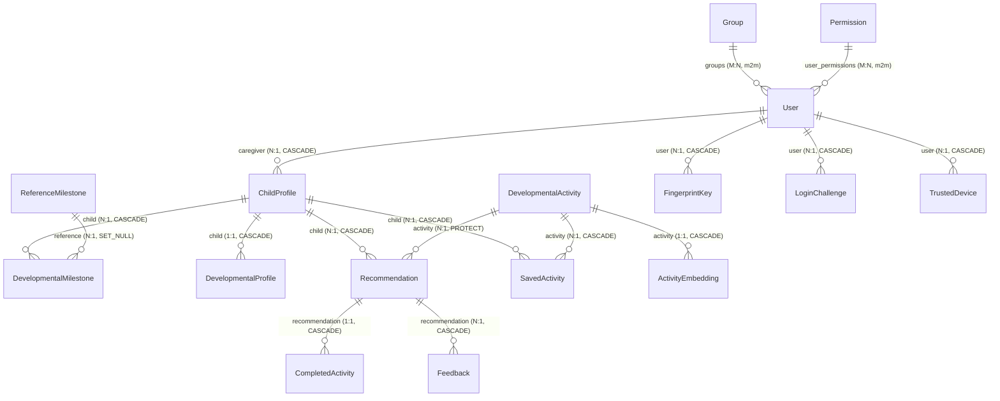
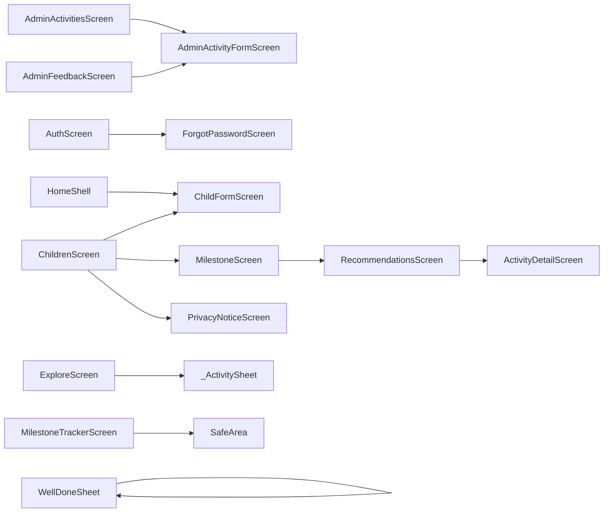

# Chapters 1-4 against the build

> Generated 2026-11-23T13:40:21+03:00 at commit `d932476` by `backend\venv\Scripts\python.exe scripts\report_evidence\sync_chapters.py`. Figures come from that run; UNKNOWN marks anything the script couldn't verify.

## 3a. Data model

`makemigrations --check --dry-run`: "No changes detected" (the models match the migrations, so this describes the migrated schema). 14 models, 130 fields. Every field with type, null, blank, default, choices, unique, index, foreign key and on_delete: `raw/model_fields.csv`. Constraints and indexes per table: `raw/model_tables.csv`. Mermaid: `raw/er_diagram.mmd`, `raw/class_diagram.mmd`.

| Model | Table | Constraints | Indexes |
|---|---|---|---|
| profiles.User | profiles_user | unique_user_email_case_insensitive: UniqueConstraint | — |
| profiles.ChildProfile | profiles_childprofile | — | — |
| profiles.ReferenceMilestone | profiles_referencemilestone | — | — |
| profiles.DevelopmentalMilestone | profiles_developmentalmilestone | — | — |
| profiles.DevelopmentalProfile | profiles_developmentalprofile | — | — |
| profiles.LoginChallenge | profiles_loginchallenge | — | — |
| profiles.TrustedDevice | profiles_trusteddevice | unique_trusted_device_per_user: UniqueConstraint | — |
| profiles.FingerprintKey | profiles_fingerprintkey | — | — |
| activities.DevelopmentalActivity | activities_developmentalactivity | unique_activity_name_per_domain: UniqueConstraint | — |
| recommendations.Recommendation | recommendations_recommendation | similarity_score_between_-1_and_1: CheckConstraint; ranking_score_between_0_and_1: CheckConstraint; rule_priority_between_0_and_1: CheckConstraint; age_weight_between_0_and_1: CheckConstraint; alpha_between_0_and_1: CheckConstraint; position_between_1_and_5: CheckConstraint; unique_position_per_batch: UniqueConstraint; unique_activity_per_batch: UniqueConstraint | — |
| recommendations.ActivityEmbedding | recommendations_activityembedding | — | — |
| recommendations.SavedActivity | recommendations_savedactivity | unique_saved_activity: UniqueConstraint | — |
| feedback.CompletedActivity | feedback_completedactivity | — | — |
| feedback.Feedback | feedback_feedback | rating_between_1_and_5: CheckConstraint | — |

Foreign keys (from the ER diagram):

## 3b. API

Every endpoint under `/api/` from the URL resolver, with its view, methods, permission and throttle classes (`raw/api_endpoints.csv`). Authentication everywhere is the project default (`REST_FRAMEWORK.DEFAULT_AUTHENTICATION_CLASSES` in `backend/nurtura_backend/settings.py:236`) unless a view sets its own. Fictional request and response examples for the main flow: `raw/workflow_transcript.json` (12 calls, see `07_workflow_transcript.md`).

| Endpoint | Methods | View | Permissions | Throttle | Source |
|---|---|---|---|---|---|
| `/api/auth/register/` | POST | RegisterView | AllowAny | — | backend/profiles/views.py:50 |
| `/api/auth/login/` | POST | LoginView | default | ScopedRateThrottle (scope login) | backend/profiles/views.py:75 |
| `/api/auth/login/verify/` | POST | VerifyLoginView | AllowAny | ScopedRateThrottle (scope two_factor) | backend/profiles/views.py:132 |
| `/api/auth/login/resend/` | POST | ResendCodeView | AllowAny | ScopedRateThrottle (scope two_factor) | backend/profiles/views.py:156 |
| `/api/auth/password-reset/` | POST | PasswordResetView | AllowAny | ScopedRateThrottle (scope password_reset) | backend/profiles/views.py:172 |
| `/api/auth/password-reset/resend/` | POST | PasswordResetResendView | AllowAny | ScopedRateThrottle (scope two_factor) | backend/profiles/views.py:192 |
| `/api/auth/password-reset/verify/` | POST | PasswordResetVerifyView | AllowAny | ScopedRateThrottle (scope two_factor) | backend/profiles/views.py:210 |
| `/api/auth/password-reset/confirm/` | POST | PasswordResetConfirmView | AllowAny | ScopedRateThrottle (scope two_factor) | backend/profiles/views.py:239 |
| `/api/auth/google/` | POST | GoogleSignInView | AllowAny | ScopedRateThrottle (scope login) | backend/profiles/views.py:391 |
| `/api/auth/fingerprint/` | DELETE, POST | FingerprintView | IsAuthenticated | — | backend/profiles/views.py:348 |
| `/api/auth/fingerprint/login/` | POST | FingerprintLoginView | AllowAny | ScopedRateThrottle (scope login) | backend/profiles/views.py:371 |
| `/api/auth/logout/` | POST | LogoutView | IsAuthenticated | — | backend/profiles/views.py:434 |
| `/api/auth/me/` | DELETE, GET | MeView | IsAuthenticated |  (scope account_delete) | backend/profiles/views.py:473 |
| `/api/auth/password/` | POST | ChangePasswordView | IsAuthenticated | ScopedRateThrottle (scope login) | backend/profiles/views.py:300 |
| `/api/auth/privacy-consent/` | POST | PrivacyConsentView | IsAuthenticated | — | backend/profiles/views.py:452 |
| `/api/privacy-notice/` | GET | PrivacyNoticeView | AllowAny | — | backend/profiles/views.py:442 |
| `/api/children/` | GET, POST | ChildProfileViewSet | IsCaregiver, HasPrivacyConsent | — | backend/profiles/views.py:518 |
| `/api/children/<pk>/` | DELETE, GET, PATCH, PUT | ChildProfileViewSet | IsCaregiver, HasPrivacyConsent | — | backend/profiles/views.py:518 |
| `/api/children/<pk>/milestones/` | GET, POST | ChildProfileViewSet | IsCaregiver, HasPrivacyConsent | — | backend/profiles/views.py:518 |
| `/api/children/<pk>/observation/` | GET | ChildProfileViewSet | IsCaregiver, HasPrivacyConsent | — | backend/profiles/views.py:518 |
| `/api/children/<pk>/profile/` | GET | ChildProfileViewSet | IsCaregiver, HasPrivacyConsent | — | backend/profiles/views.py:518 |
| `/api/children/<pk>/tracker/` | GET | ChildProfileViewSet | IsCaregiver, HasPrivacyConsent | — | backend/profiles/views.py:518 |
| `/api/reference-milestones/` | GET | ReferenceMilestoneViewSet | IsAuthenticated | — | backend/profiles/views.py:587 |
| `/api/reference-milestones/<pk>/` | GET | ReferenceMilestoneViewSet | IsAuthenticated | — | backend/profiles/views.py:587 |
| `/api/` | GET | APIRootView | IsAuthenticated | — | backend/venv/Lib/site-packages/rest_framework/routers.py:314 |
| `/api/children/<int:child_id>/candidates/` | GET | ChildCandidatesView | IsCaregiver | — | backend/recommendations/views.py:24 |
| `/api/children/<int:child_id>/recommendations/` | GET, POST | ChildRecommendationsView | IsCaregiver | — | backend/recommendations/views.py:118 |
| `/api/children/<int:child_id>/activities/` | GET | ChildActivitiesView | IsCaregiver | — | backend/recommendations/views.py:226 |
| `/api/children/<int:child_id>/activities/<str:activity_id>/try/` | POST | TryActivityView | IsCaregiver | — | backend/recommendations/views.py:298 |
| `/api/children/<int:child_id>/saved/<str:activity_id>/` | DELETE, PUT | SavedActivityView | IsCaregiver | — | backend/recommendations/views.py:272 |
| `/api/recommendations/<int:recommendation_id>/options/` | GET, POST | RecommendationOptionsView | IsCaregiver | — | backend/recommendations/views.py:173 |
| `/api/children/<int:child_id>/activities-done/` | GET | ActivitiesDoneView | IsCaregiver | — | backend/feedback/views.py:48 |
| `/api/recommendations/<int:recommendation_id>/completion/` | DELETE, PUT | RecommendationCompletionView | IsCaregiver | — | backend/feedback/views.py:90 |
| `/api/recommendations/<int:recommendation_id>/feedback/` | GET, PUT | RecommendationFeedbackView | IsCaregiver | — | backend/feedback/views.py:136 |
| `/api/recommendations/<int:recommendation_id>/observable/` | GET | ObservableSkillsView | IsCaregiver | — | backend/feedback/views.py:173 |
| `/api/admin/overview/` | GET | AdminOverviewView | IsAdministrator | — | backend/insights/views.py:14 |
| `/api/admin/search-index/` | POST | AdminSearchIndexView | IsAdministrator | — | backend/insights/views.py:25 |
| `/api/admin/activities/` | GET, POST | AdminActivityListView | IsAdministrator | — | backend/activities/api.py:152 |
| `/api/admin/activities/suggest/` | POST | AdminActivitySuggestView | IsAdministrator | — | backend/activities/api.py:274 |
| `/api/admin/activities/<int:pk>/` | GET, PATCH, PUT | AdminActivityDetailView | IsAdministrator | — | backend/activities/api.py:180 |
| `/api/admin/activities/<int:pk>/status/` | POST | AdminActivityStatusView | IsAdministrator | — | backend/activities/api.py:213 |
| `/api/admin/choices/` | GET | AdminChoicesView | IsAdministrator | — | backend/activities/api.py:237 |
| `/api/admin/feedback/` | GET | AdminFeedbackListView | IsAdministrator | — | backend/feedback/admin_api.py:25 |

## 3c. Permissions matrix (observed)

Each endpoint and method was called with an empty JSON body as four users: anonymous, the child's own caregiver, another caregiver and an administrator. Each call ran in its own savepoint and was rolled back. 400 means the request got past the permission check and was refused for its (empty) body. Raw: `raw/permission_probe.csv`. Both caregivers have agreed to the privacy notice: until a caregiver agrees, every write except DELETE is refused with 403 (`HasPrivacyConsent`, `backend/profiles/permissions.py:16`).

| Endpoint | Method | Anonymous | Own caregiver | Other caregiver | Administrator |
|---|---|---|---|---|---|
| `/api/auth/register/` | POST | 400 (allowed; bad body) | 400 (allowed; bad body) | 400 (allowed; bad body) | 400 (allowed; bad body) |
| `/api/auth/login/` | POST | 400 (allowed; bad body) | 400 (allowed; bad body) | 400 (allowed; bad body) | 400 (allowed; bad body) |
| `/api/auth/login/verify/` | POST | 400 (allowed; bad body) | 400 (allowed; bad body) | 400 (allowed; bad body) | 400 (allowed; bad body) |
| `/api/auth/login/resend/` | POST | 400 (allowed; bad body) | 400 (allowed; bad body) | 400 (allowed; bad body) | 400 (allowed; bad body) |
| `/api/auth/password-reset/` | POST | 400 (allowed; bad body) | 400 (allowed; bad body) | 400 (allowed; bad body) | 400 (allowed; bad body) |
| `/api/auth/password-reset/resend/` | POST | 400 (allowed; bad body) | 400 (allowed; bad body) | 400 (allowed; bad body) | 400 (allowed; bad body) |
| `/api/auth/password-reset/verify/` | POST | 400 (allowed; bad body) | 400 (allowed; bad body) | 400 (allowed; bad body) | 400 (allowed; bad body) |
| `/api/auth/password-reset/confirm/` | POST | 400 (allowed; bad body) | 400 (allowed; bad body) | 400 (allowed; bad body) | 400 (allowed; bad body) |
| `/api/auth/google/` | POST | 400 (allowed; bad body) | 400 (allowed; bad body) | 400 (allowed; bad body) | 400 (allowed; bad body) |
| `/api/auth/fingerprint/` | DELETE | 401 | 400 (allowed; bad body) | 400 (allowed; bad body) | 400 (allowed; bad body) |
| `/api/auth/fingerprint/` | POST | 401 | 400 (allowed; bad body) | 400 (allowed; bad body) | 400 (allowed; bad body) |
| `/api/auth/fingerprint/login/` | POST | 400 (allowed; bad body) | 400 (allowed; bad body) | 400 (allowed; bad body) | 400 (allowed; bad body) |
| `/api/auth/logout/` | POST | 401 | 204 | 204 | 204 |
| `/api/auth/me/` | DELETE | 401 | 400 (allowed; bad body) | 400 (allowed; bad body) | 403 |
| `/api/auth/me/` | GET | 401 | 200 | 200 | 200 |
| `/api/auth/password/` | POST | 401 | 400 (allowed; bad body) | 400 (allowed; bad body) | 400 (allowed; bad body) |
| `/api/auth/privacy-consent/` | POST | 401 | 400 (allowed; bad body) | 400 (allowed; bad body) | 400 (allowed; bad body) |
| `/api/privacy-notice/` | GET | 200 | 200 | 200 | 200 |
| `/api/children/` | GET | 401 | 200 | 200 | 403 |
| `/api/children/` | POST | 401 | 400 (allowed; bad body) | 400 (allowed; bad body) | 403 |
| `/api/children/<pk>/` | DELETE | 401 | 204 | 404 | 403 |
| `/api/children/<pk>/` | GET | 401 | 200 | 404 | 403 |
| `/api/children/<pk>/` | PATCH | 401 | 200 | 404 | 403 |
| `/api/children/<pk>/` | PUT | 401 | 400 (allowed; bad body) | 404 | 403 |
| `/api/children/<pk>/milestones/` | GET | 401 | 200 | 404 | 403 |
| `/api/children/<pk>/milestones/` | POST | 401 | 400 (allowed; bad body) | 404 | 403 |
| `/api/children/<pk>/observation/` | GET | 401 | 200 | 404 | 403 |
| `/api/children/<pk>/profile/` | GET | 401 | 200 | 404 | 403 |
| `/api/children/<pk>/tracker/` | GET | 401 | 200 | 404 | 403 |
| `/api/reference-milestones/` | GET | 401 | 200 | 200 | 200 |
| `/api/reference-milestones/<pk>/` | GET | 401 | 200 | 200 | 200 |
| `/api/` | GET | 401 | 200 | 200 | 200 |
| `/api/children/<int:child_id>/candidates/` | GET | 401 | 200 | 404 | 403 |
| `/api/children/<int:child_id>/recommendations/` | GET | 401 | 200 | 404 | 403 |
| `/api/children/<int:child_id>/recommendations/` | POST | 401 | 200 | 404 | 403 |
| `/api/children/<int:child_id>/activities/` | GET | 401 | 200 | 404 | 403 |
| `/api/children/<int:child_id>/activities/<str:activity_id>/try/` | POST | 401 | 400 (allowed; bad body) | 404 | 403 |
| `/api/children/<int:child_id>/saved/<str:activity_id>/` | DELETE | 401 | 204 | 404 | 403 |
| `/api/children/<int:child_id>/saved/<str:activity_id>/` | PUT | 401 | 201 | 404 | 403 |
| `/api/recommendations/<int:recommendation_id>/options/` | GET | 401 | 200 | 404 | 403 |
| `/api/recommendations/<int:recommendation_id>/options/` | POST | 401 | 400 (allowed; bad body) | 404 | 403 |
| `/api/children/<int:child_id>/activities-done/` | GET | 401 | 200 | 404 | 403 |
| `/api/recommendations/<int:recommendation_id>/completion/` | DELETE | 401 | 204 | 404 | 403 |
| `/api/recommendations/<int:recommendation_id>/completion/` | PUT | 401 | 201 | 404 | 403 |
| `/api/recommendations/<int:recommendation_id>/feedback/` | GET | 401 | 404 | 404 | 403 |
| `/api/recommendations/<int:recommendation_id>/feedback/` | PUT | 401 | 201 | 404 | 403 |
| `/api/recommendations/<int:recommendation_id>/observable/` | GET | 401 | 200 | 404 | 403 |
| `/api/admin/overview/` | GET | 401 | 403 | 403 | 200 |
| `/api/admin/search-index/` | POST | 401 | 403 | 403 | 200 |
| `/api/admin/activities/` | GET | 401 | 403 | 403 | 200 |
| `/api/admin/activities/` | POST | 401 | 403 | 403 | 400 (allowed; bad body) |
| `/api/admin/activities/suggest/` | POST | 401 | 403 | 403 | 400 (allowed; bad body) |
| `/api/admin/activities/<int:pk>/` | GET | 401 | 403 | 403 | 200 |
| `/api/admin/activities/<int:pk>/` | PATCH | 401 | 403 | 403 | 200 |
| `/api/admin/activities/<int:pk>/` | PUT | 401 | 403 | 403 | 400 (allowed; bad body) |
| `/api/admin/activities/<int:pk>/status/` | POST | 401 | 403 | 403 | 400 (allowed; bad body) |
| `/api/admin/choices/` | GET | 401 | 403 | 403 | 200 |
| `/api/admin/feedback/` | GET | 401 | 403 | 403 | 200 |

## 3d. Admin site (`/admin/`)

Who can enter: Django's `AdminSite.has_permission` requires an active staff user. `is_staff` is derived from the role, so only Administrators have it (`backend/profiles/models.py:71`). The negative test is in `14_security_privacy_deployment.md`. `raw/admin_site.csv`.

| Model | Columns | Filters | Search | Actions | Read-only |
|---|---|---|---|---|---|
| activities.DevelopmentalActivity | activity_id, activity_name, developmental_domain, age_range, difficulty_level, source, source_link, content_status, feedback_count, average_rating | content_status, source, HasSourceUrlFilter, developmental_domain, age_range, difficulty_level | activity_id, activity_name, description | submit_for_review, publish, return_to_draft | content_status |
| auth.Group | __str__ | — | name | — | — |
| authtoken.TokenProxy | key, user, created | created | user__username | — | — |
| feedback.CompletedActivity | completion_date, activity_id, activity, area, status | status, recommendation__activity__developmental_domain | recommendation__activity__activity_id, recommendation__activity__activity_name | — | activity_id, activity, area, status, completion_date |
| feedback.Feedback | date_submitted, activity_id, activity, area, stars, outcome, interest, issue_labels, comment_excerpt, completion | outcome, interest, rating, recommendation__activity__developmental_domain | recommendation__activity__activity_id, recommendation__activity__activity_name, comment | — | activity_id, activity, area, outcome, interest, issue_labels, rating, comment, completion, date_submitted |
| profiles.ChildProfile | name, caregiver, date_of_birth, gender | — | name, caregiver__username | — | — |
| profiles.DevelopmentalMilestone | child, domain, status, observation_date, reference | domain, status | — | — | — |
| profiles.DevelopmentalProfile | child, top_domain, age_months, generated_at | — | — | — | child, age_months, scores, ranked_domains, reasons, generated_at |
| profiles.LoginChallenge | user, purpose, created_at, expires_at, sends, attempts, used_at | purpose | user__username, user__email | — | — |
| profiles.ReferenceMilestone | milestone_key, expected_age_months, domain, description, source, verified | verified, source, domain, expected_age_months | milestone_key, description | mark_verified, mark_unverified | — |
| profiles.TrustedDevice | user, trusted_until, last_used_at, created_at | — | user__username, user__email | — | user, device_hash, trusted_until, created_at, last_used_at |
| profiles.User | username, email, role, is_active, is_superuser | role, is_active, is_superuser | username, first_name, last_name, email | — | — |
| recommendations.Recommendation | child, activity, similarity_score, ranking_score, date_generated | activity__developmental_domain | child__name, activity__activity_name | — | — |

## 3e. Management commands

"Writes" is read from each command's source (database calls such as `.save(`, `.create(`, `.update(`, `.delete(`; file writes such as `open(..., "w")`). `raw/management_commands.csv` has the options.

| Command | Purpose | Writes DB | Writes files | --dry-run |
|---|---|---|---|---|
| `alpha_sensitivity` | Score every alpha at the app's retrieval beta (sensitivity check). | no | no | no |
| `compare_embedding_model` | Compare a candidate embedding model on the held-out labels. | yes | yes | no |
| `compare_tfidf` | Compare SBERT, TF-IDF and their hybrid on the held-out labels. | yes | yes | no |
| `embed_activities` | Embed Published activities with SBERT for semantic retrieval. | yes | no | yes |
| `evaluate_alpha_grid` | Grid-search alpha on the held-out tune set and report on the test set. | no | no | no |
| `evaluate_beyond_accuracy` | Diversity, novelty, coverage and personalisation of the top 5. | no | no | no |
| `evaluate_learned_ranker` | Train a learned ranker on the tune children and test it once. | yes | yes | no |
| `evaluate_statistics` | Paired statistics and age-weight sensitivity on the held-out set. | no | no | no |
| `evaluate_v3_full` | Full offline evaluation of the current system (v3). | yes | yes | no |
| `evaluate_v3_statistics` | Paired significance tests for the v3 configuration (SBERT + TF-IDF). | no | no | no |
| `explanation_samples` | Print the top recommendation and its explanation for held-out children. | no | no | no |
| `export_heldout_labels` | Write the pooled, shuffled held-out labelling sheet. | no | yes | no |
| `export_relevance_template` | Write the relevance-labelling CSV template for the sample children. | no | yes | no |
| `load_plain_aims` | Load reviewed plain_aim wording; never changes content status. | yes | no | yes |
| `seed_activities` | Load data/processed/activities_clean.csv into DevelopmentalActivity. | yes | no | yes |
| `seed_milestones` | Load data/reference/developmental_milestones.csv into ReferenceMilestone. | yes | no | yes |
| `spot_check_retrieval` | Show retrieval results for sample profiles, for checking by hand. | yes | no | no |
| `train_activity_classifier` | Train and cross-validate the activity area and age-band classifier. | yes | yes | no |

## 3f. Mobile app

The app has no named routes: screens are pushed with `MaterialPageRoute` or opened as bottom sheets. The home shell has the tabs tab_today, tab_explore, tab_progress, tab_milestones, tab_family. Per file: screens, the service classes it names, and whether it has loading, empty and error handling (found by pattern in the source; `raw/mobile_screens_map.csv`). Service classes and their API calls: `raw/mobile_services.json`. Navigation edges: `raw/mobile_navigation.mmd`.

| File | Screens | Services named | Loading | Empty | Error |
|---|---|---|---|---|---|
| screens/activity_detail_screen.dart | ActivityDetailScreen _Stars _DetailCard | ApiClient ApiException RecommendationService | no | yes | yes |
| screens/admin/admin_account_screen.dart | AdminAccountScreen | — | no | no | no |
| screens/admin/admin_activities_screen.dart | AdminActivitiesScreen StatusPill _ActivityCard | AdminService ApiClient ApiException | yes | yes | yes |
| screens/admin/admin_activity_form_screen.dart | AdminActivityFormScreen _StatusPanel | AdminService ApiClient ApiException | yes | yes | yes |
| screens/admin/admin_dashboard_screen.dart | AdminDashboardScreen _Section _OverviewCard | AdminService ApiClient ApiException | yes | yes | yes |
| screens/admin/admin_feedback_screen.dart | AdminFeedbackScreen _FeedbackCard | AdminService ApiClient ApiException | yes | yes | yes |
| screens/admin/admin_shell.dart | AdminShell AdminHeader | — | no | no | no |
| screens/auth_screen.dart | AuthScreen _FingerprintLogIn _OrDivider | ApiException | no | no | yes |
| screens/change_password_screen.dart | ChangePasswordScreen | ApiException | no | no | yes |
| screens/child_form_screen.dart | ChildFormScreen _DateField | ApiException | yes | no | yes |
| screens/children_screen.dart | ChildrenScreen _ChildCard _DeleteAccountDialog | ApiException | yes | no | yes |
| screens/explore_screen.dart | ExploreScreen _Heading _ActivityCard | ApiClient ApiException ExploreService | yes | no | yes |
| screens/forgot_password_screen.dart | ForgotPasswordScreen _StepDots | ApiException CodeChallenge | no | no | yes |
| screens/home_shell.dart | HomeShell | — | no | no | no |
| screens/lock_screen.dart | LockScreen | — | no | no | yes |
| screens/milestone_screen.dart | MilestoneScreen _MilestoneTile _StatusChip | ApiClient ApiException MilestoneService | yes | yes | yes |
| screens/milestone_tracker_screen.dart | MilestoneTrackerScreen _MilestoneCard _ObservationCard | ApiClient ApiException MilestoneService | yes | no | yes |
| screens/milestones_tab.dart | MilestonesTab | — | no | no | no |
| screens/privacy_notice_screen.dart | PrivacyNoticeScreen | ApiException | yes | no | yes |
| screens/progress_screen.dart | ProgressScreen _SectionTitle _Hero | ApiClient ApiException MilestoneService RecommendationService | yes | no | yes |
| screens/recommendations_screen.dart | RecommendationsScreen RecommendationCard ReferralNotice | ApiClient ApiException RecommendationService | yes | yes | yes |
| screens/verify_code_screen.dart | VerifyCodeScreen CodeBoxes | ApiException | no | no | yes |
| widgets/well_done_sheet.dart | WellDoneSheet _InterestButton | ApiException RecommendationService | no | yes | yes |

API calls by service class:

| Service | Calls |
|---|---|
| AdminService | GET `/api/admin/activities/` GET `/api/admin/activities/$id/` GET `/api/admin/choices/` GET `/api/admin/feedback/` GET `/api/admin/overview/` PATCH `/api/admin/activities/$id/` POST `/api/admin/activities/` POST `/api/admin/activities/$id/status/` POST `/api/admin/activities/suggest/` POST `/api/admin/search-index/` |
| ApiClient | — |
| ApiException | — |
| AuthResult | DELETE `/api/auth/fingerprint/` DELETE `/api/auth/me/` GET `/api/auth/me/` GET `/api/privacy-notice/` POST `/api/auth/fingerprint/` POST `/api/auth/fingerprint/login/` POST `/api/auth/google/` POST `/api/auth/login/` POST `/api/auth/login/resend/` POST `/api/auth/login/verify/` POST `/api/auth/logout/` POST `/api/auth/password-reset/` POST `/api/auth/password-reset/confirm/` POST `/api/auth/password-reset/resend/` POST `/api/auth/password-reset/verify/` POST `/api/auth/password/` POST `/api/auth/privacy-consent/` POST `/api/auth/register/` |
| AuthService | DELETE `/api/auth/fingerprint/` DELETE `/api/auth/me/` GET `/api/auth/me/` GET `/api/privacy-notice/` POST `/api/auth/fingerprint/` POST `/api/auth/fingerprint/login/` POST `/api/auth/google/` POST `/api/auth/login/` POST `/api/auth/login/resend/` POST `/api/auth/login/verify/` POST `/api/auth/logout/` POST `/api/auth/password-reset/` POST `/api/auth/password-reset/confirm/` POST `/api/auth/password-reset/resend/` POST `/api/auth/password-reset/verify/` POST `/api/auth/password/` POST `/api/auth/privacy-consent/` POST `/api/auth/register/` |
| BiometricsError | — |
| ChildService | DELETE `/api/children/$id/` GET `/api/children/` PATCH `/api/children/$id/` POST `/api/children/` |
| CodeChallenge | DELETE `/api/auth/fingerprint/` DELETE `/api/auth/me/` GET `/api/auth/me/` GET `/api/privacy-notice/` POST `/api/auth/fingerprint/` POST `/api/auth/fingerprint/login/` POST `/api/auth/google/` POST `/api/auth/login/` POST `/api/auth/login/resend/` POST `/api/auth/login/verify/` POST `/api/auth/logout/` POST `/api/auth/password-reset/` POST `/api/auth/password-reset/confirm/` POST `/api/auth/password-reset/resend/` POST `/api/auth/password-reset/verify/` POST `/api/auth/password/` POST `/api/auth/privacy-consent/` POST `/api/auth/register/` |
| CodeRequired | DELETE `/api/auth/fingerprint/` DELETE `/api/auth/me/` GET `/api/auth/me/` GET `/api/privacy-notice/` POST `/api/auth/fingerprint/` POST `/api/auth/fingerprint/login/` POST `/api/auth/google/` POST `/api/auth/login/` POST `/api/auth/login/resend/` POST `/api/auth/login/verify/` POST `/api/auth/logout/` POST `/api/auth/password-reset/` POST `/api/auth/password-reset/confirm/` POST `/api/auth/password-reset/resend/` POST `/api/auth/password-reset/verify/` POST `/api/auth/password/` POST `/api/auth/privacy-consent/` POST `/api/auth/register/` |
| ExploreService | DELETE `/api/children/$childId/saved/$activityId/` GET `/api/children/$childId/activities/` POST `/api/children/$childId/activities/$activityId/try/` PUT `/api/children/$childId/saved/$activityId/` |
| GooglePlayIdTokens | — |
| LocalAuthBiometrics | — |
| MilestoneService | GET `/api/children/$childId/milestones/` GET `/api/children/$childId/observation/` GET `/api/children/$childId/tracker/` GET `/api/reference-milestones/` POST `/api/children/$childId/milestones/` |
| NoBiometrics | — |
| RecommendationService | DELETE `/api/recommendations/$recommendationId/completion/` GET `/api/children/$childId/activities-done/` GET `/api/recommendations/$recommendationId/observable/` GET `/api/recommendations/$recommendationId/options/` POST `/api/recommendations/$recommendationId/options/` PUT `/api/recommendations/$recommendationId/completion/` PUT `/api/recommendations/$recommendationId/feedback/` |
| SignedIn | DELETE `/api/auth/fingerprint/` DELETE `/api/auth/me/` GET `/api/auth/me/` GET `/api/privacy-notice/` POST `/api/auth/fingerprint/` POST `/api/auth/fingerprint/login/` POST `/api/auth/google/` POST `/api/auth/login/` POST `/api/auth/login/resend/` POST `/api/auth/login/verify/` POST `/api/auth/logout/` POST `/api/auth/password-reset/` POST `/api/auth/password-reset/confirm/` POST `/api/auth/password-reset/resend/` POST `/api/auth/password-reset/verify/` POST `/api/auth/password/` POST `/api/auth/privacy-consent/` POST `/api/auth/register/` |

## 3g. The recommendation request, step by step

| # | Step | Where |
|---|---|---|
| 1 | App sends POST /api/children/<id>/recommendations/ | mobile/nurtura_app/lib/services/recommendation_service.dart:5 |
| 2 | View checks the caregiver and calls generate() | backend/recommendations/views.py:138 |
| 3 | Lock the child row so concurrent requests store one batch | backend/recommendations/generation.py:275 |
| 4 | Rank: rule engine + retrieval + scoring | backend/recommendations/generation.py:278 |
| 5 | Build the developmental profile from milestones, concerns and interests | backend/profiles/rules/__init__.py:38 |
| 6 | Rule engine: baseline + rule adjustments, normalised to 0-1 | backend/profiles/rules/engine.py:109 |
| 7 | Write the plain-language query | backend/recommendations/retrieval.py:83 |
| 8 | Encode the query with SBERT; dot product with stored vectors | backend/recommendations/retrieval.py:141 |
| 9 | Score every eligible activity: age weight x ((1-alpha) sim + alpha priority) | backend/recommendations/ranking.py:127 |
| 10 | Personalise from feedback (boost liked, demote not working) | backend/recommendations/generation.py:279 |
| 11 | Leave out completed activities; keep pinned ones first | backend/recommendations/generation.py:289 |
| 12 | Take the top 5 | backend/recommendations/generation.py:297 |
| 13 | Explain each one | backend/recommendations/generation.py:311 |
| 14 | Store a new batch, or return the identical newest one | backend/recommendations/generation.py:319 |
| 15 | Response: cards + clinic-visit referral (201 new, 200 same) | backend/recommendations/views.py:144 |

## 3h. Where the build differs from the requirement text or the report

From `docs/requirements_traceability.md` (rows that are met with a deviation or partly met, and its "Wording to update" list) and deviations stated in the docs. `raw/deviations.csv`. The proposal document isn't in the repository, so differences it alone records can't be checked here.

| What | Difference | Evidence |
|---|---|---|
| FR-01 Registration and authentication | self-registration always creates a Caregiver. The first administrator is made with `createsuperuser` and others from the web admin, so nobody can register as one. Apple sign-in (wireframe) was not built. | docs/requirements_traceability.md:46 |
| FR-03 Child profile management | `preferences` is stored and accepted by the API, but the app doesn't ask for it and nothing uses it. Contextual information (home, resources, routines) isn't collected. | docs/requirements_traceability.md:48 |
| FR-04 Developmental information recording | developmental goals aren't collected. Free-text milestones aren't accepted, so every observation maps to a catalogue milestone. | docs/requirements_traceability.md:49 |
| FR-05 Developmental profile generation | a custom engine, not experta (Section 3.2.2 allowed either). | docs/requirements_traceability.md:50 |
| FR-10 Ranking and scoring | ranks by developmental need, similarity and age fit. Caregiver preferences and context aren't weighted. Interests enter only through the retrieval query and the explanation. Feedback changes later suggestions only through the options and personalisation steps (#175 to #180). | docs/requirements_traceability.md:55 |
| NFR-08 Compatibility | Android only. iOS was removed (#186). | docs/requirements_traceability.md:76 |
| NFR-12 Recommendation quality | relevance is judged by graded human labels, not similarity scores. Area diversity is low (about 1.4 areas per top 5) because the priority area comes first. | docs/requirements_traceability.md:80 |
| DR-02 Child profile data | age, interests, gender and concerns are stored; preferences are stored but unused; context isn't stored. | docs/requirements_traceability.md:88 |
| DR-03 Developmental data | goals aren't stored. | docs/requirements_traceability.md:89 |
| DR-11 Data protection | access is restricted by role (NFR-03). Data is in a local PostgreSQL on the development machine; secure hosting waits for deployment. | docs/requirements_traceability.md:97 |
| IR-09 Secure communication | HTTPS depends on deployment, which is on hold. Development runs over local HTTP (`adb reverse` or the hotspot). | docs/requirements_traceability.md:111 |
| Report wording: FR-01 | administrators are created with `createsuperuser` or the web admin, not by registration. | docs/requirements_traceability.md:136 |
| Report wording: FR-03, DR-02 | preferences and context are not collected, or are future work. | docs/requirements_traceability.md:137 |
| Report wording: FR-04, DR-03 | milestones come from the CDC/WHO catalogue with status Achieved, Emerging or Not yet; developmental goals are not collected. | docs/requirements_traceability.md:138 |
| Report wording: FR-05 | a custom IF-THEN engine (not experta). | docs/requirements_traceability.md:139 |
| Report wording: FR-10 | ranking is `age_weight × ((1 − α)·similarity + α·priority)`; preferences and context aren't weighted. | docs/requirements_traceability.md:140 |
| Report wording: FR-11, NFR-10 | explanations name the area, milestones or concerns, age fit and interests; scores aren't shown to caregivers. | docs/requirements_traceability.md:141 |
| Report wording: NFR-01 | a measurable threshold, for example "95% of requests within 1 second after start-up on the reference environment". | docs/requirements_traceability.md:142 |
| Report wording: NFR-08 | Android only. | docs/requirements_traceability.md:143 |
| Report wording: NFR-12 | relevance judged by graded human labels with precision@k and nDCG@k, not similarity scores. | docs/requirements_traceability.md:144 |
| Report wording: DR-09 and Section 3.2.2 | vectors stored in PostgreSQL, not FAISS. | docs/requirements_traceability.md:145 |
| Report wording: FR-09, IR-06 | retrieval combines SBERT with TF-IDF word matching, `0.25 × SBERT + 0.75 × TF-IDF`, both compared by cosine similarity (#248, #250). | docs/requirements_traceability.md:146 |
| Report wording: Additions | state the SOFIA additions above, with their own IDs if the chapter is renumbered. | docs/requirements_traceability.md:147 |

## 3i. Merged since tag `sprint6-explanations-v1` (2026-10-10)

96 pull requests (`gh pr list --state merged`, merged after the tag's commit date). `raw/changes_since_sprint6.csv`.

| PR | Merged | Title |
|---|---|---|
| #88 | 2026-10-14 | feat: activity detail screen from a recommendation card (#84) |
| #89 | 2026-10-14 | feat: show the last recommendations offline (#85) |
| #92 | 2026-10-14 | feat: modern, playful redesign with light and dark mode and a tabbed home (#90) |
| #87 | 2026-10-14 | feat: two-step verification by emailed code for app login (#86) |
| #93 | 2026-10-14 | feat: two-step verification code screen in the app (#91) |
| #97 | 2026-10-14 | feat: mark a recommendation as completed (#94) |
| #98 | 2026-10-14 | feat: submit feedback on a recommendation via FeedbackManager (#95) |
| #99 | 2026-10-14 | feat: administrator feedback review (#96) |
| #101 | 2026-10-14 | feat: mark done and leave feedback from the activity screen (#100) |
| #103 | 2026-10-14 | fix: stay signed in when the app is opened offline (#102) |
| #105 | 2026-10-14 | test: end-to-end round trip on the real backend for the tabbed app (#104) |
| #107 | 2026-10-15 | docs: bring PROJECT_OVERVIEW.md up to date after Sprints 6-8 (#106) |
| #109 | 2026-10-15 | test: make the end-to-end test pass on a real Android phone (#108) |
| #111 | 2026-10-15 | docs: testing and evaluation record, phone-run screenshots and demo checklist (#110) |
| #113 | 2026-10-15 | feat: 'Village in Your Pocket' restyle, app icon and splash (#112) |
| #115 | 2026-10-15 | feat: style the Django admin to match the app's village theme (#114) |
| #117 | 2026-10-16 | feat: analytics dashboard on the admin home page (#116) |
| #119 | 2026-10-21 | docs: align the repository with the Sprint I and Sprint II review requirements (#118) |
| #124 | 2026-10-21 | feat: administrator API for the app (overview, activities, feedback) (#122) |
| #125 | 2026-10-21 | feat: administrator screens in the Flutter app (#123) |
| #127 | 2026-10-21 | feat: reset a forgotten password with an emailed code (#126) |
| #129 | 2026-10-22 | feat: work with Google's "Suggest strong password" and password saving (#128) |
| #131 | 2026-10-25 | feat: Continue with Google, as a choice next to email (#130) |
| #133 | 2026-10-25 | docs: caregiver evaluation materials (#132) |
| #135 | 2026-10-29 | feat: delete my account, and edit or delete a child in the app (#134) |
| #137 | 2026-10-29 | feat: privacy notice and consent before adding a child's data (#136) |
| #139 | 2026-10-29 | feat: full activity details, and polish from the phone walkthrough (#138) |
| #141 | 2026-10-29 | feat: a livelier sign-in screen, and a password strength meter (#140) |
| #143 | 2026-10-29 | feat: change password while signed in, for caregivers and admins (#142) |
| #145 | 2026-10-29 | fix: say when a code email can't be sent, instead of a 500 (#144) |
| #148 | 2026-10-29 | feat: strength meter on the Change password screen (#147) |
| #149 | 2026-10-29 | feat: reset a password in three steps: email, code, new password (#146) |
| #151 | 2026-10-29 | feat: fingerprint log-in and lock (#150) |
| #153 | 2026-10-29 | fix: log out straight to the login screen (#152) |
| #155 | 2026-10-30 | data: source links for the 24 activities that had none (#154) |
| #157 | 2026-10-30 | data: 200 more activities from verified sources (#156) |
| #159 | 2026-10-30 | data: 200 more activities from verified sources, batch 6 (#158) |
| #163 | 2026-10-31 | data: fix or remove the 7 activities their source did not support (#160) |
| #164 | 2026-10-31 | feat: suggest a clinic visit when a due milestone is "Not yet" (#161) |
| #165 | 2026-10-31 | feat: log-in tokens expire after 30 days (#162) |
| #167 | 2026-10-31 | data: approve the plain aims for batches 5 and 6 (#166) |
| #169 | 2026-10-31 | test: held-out evaluation v2 sheet on the 449-activity pool (#168) |
| #171 | 2026-11-02 | docs: held-out evaluation v2 results on 449 activities (#170) |
| #173 | 2026-11-02 | test: tool and plan to compare a search-trained embedding model (#172) |
| #176 | 2026-11-03 | feat: ask how an activity went and what got in the way (#175) |
| #178 | 2026-11-03 | feat: offer options after feedback, and pin the one chosen (#177) |
| #180 | 2026-11-03 | feat: learn from each child's feedback when generating ideas (#179) |
| #182 | 2026-11-03 | feat: activity classifier for area and age band, with admin suggestions (#181) |
| #187 | 2026-11-03 | chore: remove the iOS project; Nurtura is an Android app (#186) |
| #184 | 2026-11-06 | test: learned ranker trained on the tune children (#183) |
| #188 | 2026-11-06 | feat: "Well done!" sheet with interest level and skills seen (#185) |
| #189 | 2026-11-09 | docs: learned ranker results; alpha = 0.7 stays (#183) |
| #191 | 2026-11-09 | chore: one data file per section (#190) |
| #193 | 2026-11-09 | feat: milestone tracker by area, with a weekly Nurtura observation (#192) |
| #195 | 2026-11-09 | feat: Explore tab to browse, search, save and try activities (#194) |
| #197 | 2026-11-09 | test: confidence intervals, Wilcoxon tests and age-weight sensitivity for v2 (#196) |
| #201 | 2026-11-10 | docs: requirements traceability against proposal Chapter 4 (#198) |
| #202 | 2026-11-10 | test: diversity, novelty, coverage and personalisation of the rankings (#199) |
| #203 | 2026-11-10 | chore: app README, dev requirements and a non-blocking deploy check (#200) |
| #209 | 2026-11-12 | fix: deployment check always passes and summarises its findings (#208) |
| #205 | 2026-11-12 | docs: NFR-12 met, with the beyond-accuracy measures (#204) |
| #207 | 2026-11-12 | test: accessibility checks and fixes for large text and contrast (#206) |
| #211 | 2026-11-12 | docs: #31 hand check superseded; requirement map done (#210) |
| #213 | 2026-11-12 | fix: admin dashboard no longer fails on feedback without a rating (#212) |
| #215 | 2026-11-12 | fix: phone test findings (#214) |
| #217 | 2026-11-16 | docs: report evidence pack for Chapter 5 (#216) |
| #219 | 2026-11-16 | test: second rater's grades and weighted kappa (#218) |
| #221 | 2026-11-16 | docs: evidence pack: second rater's agreement results (#220) |
| #223 | 2026-11-16 | docs: simulated-participant pre-test of the evaluation protocol (#222) |
| #225 | 2026-11-16 | test: load test the backend under concurrent caregivers (#224) |
| #227 | 2026-11-16 | fix: connection pool, SBERT threads, query cache and error logging (#226) |
| #229 | 2026-11-16 | docs: rewrite the pre-test as a persona-based cognitive walkthrough (#228) |
| #232 | 2026-11-16 | fix: feedback edit keeps the outcome, picker fits the keyboard, Progress counts activities done (#231) |
| #234 | 2026-11-17 | docs: how to back up and restore the database (#233) |
| #236 | 2026-11-18 | data: verify the remaining 108 CDC milestones against the 2022 checklists (#235) |
| #239 | 2026-11-18 | feat: a short privacy notice first, with the agreement always in view (#238) |
| #240 | 2026-11-18 | fix: milestone picker scrolls as one on small phones (#237) |
| #241 | 2026-11-18 | test: end-to-end test on four emulated devices (#230) |
| #243 | 2026-11-18 | fix: stop the Explore interests cards overflowing (#242) |
| #245 | 2026-11-19 | feat: activities as a weekly plan instead of daily (#244) |
| #247 | 2026-11-20 | feat: rotate ideas when a new week starts (#246) |
| #252 | 2026-11-20 | fix: weekly plan tests no longer depend on the real date (#251) |
| #249 | 2026-11-20 | feat: TF-IDF + cosine similarity alongside SBERT, with an evaluated weight (#248) |
| #254 | 2026-11-20 | feat: retrieval mixes SBERT and TF-IDF at β = 0.25 (#250) |
| #255 | 2026-11-20 | feat: weekly plans run Monday to Sunday (#253) |
| #257 | 2026-11-20 | docs: refresh the report evidence pack after the weekly plan and TF-IDF (#256) |
| #259 | 2026-11-21 | fix: use Kenyan time (Africa/Nairobi) for dates (#258) |
| #261 | 2026-11-21 | test: check alpha at the SBERT/TF-IDF mix (#260) |
| #263 | 2026-11-21 | docs: record activity difficulty levels as future work (#262) |
| #265 | 2026-11-21 | docs: refresh the report evidence pack after Kenyan time and the α check (#264) |
| #267 | 2026-11-22 | docs: final refresh of the report evidence pack before submission (#266) |
| #269 | 2026-11-22 | test: significance tests for the v3 configuration (#268) |
| #271 | 2026-11-22 | test: full evaluation of the current system, v3 (#270) |
| #273 | 2026-11-23 | test: blind grading sheet for the ungraded v3 pairs (#272) |
| #275 | 2026-11-23 | data: add the graded v3 pairs and complete the full v3 evaluation (#274) |
| #277 | 2026-11-23 | docs: bring the README up to date with the current system and results (#276) |
